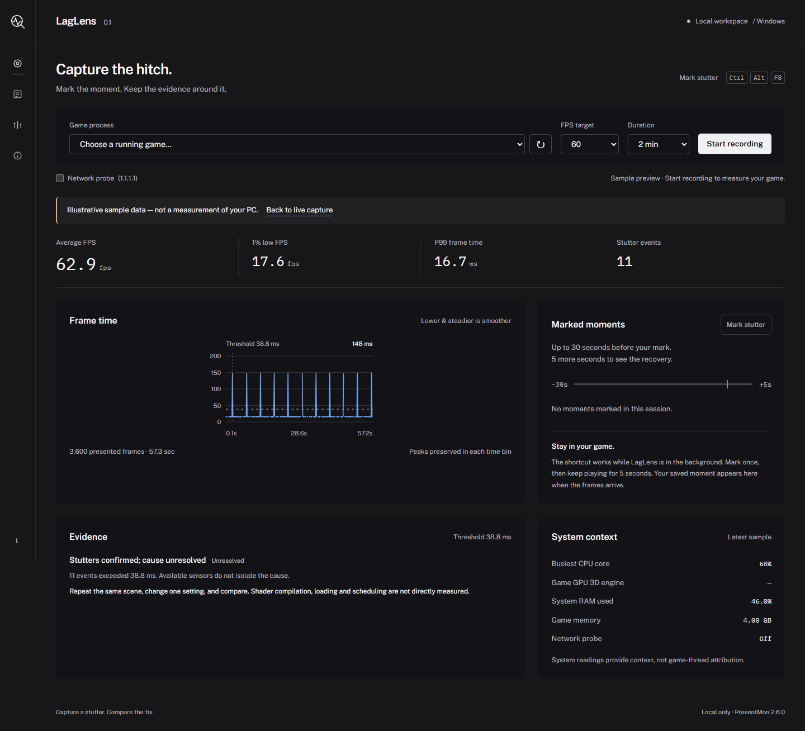

# LagLens

**Capture a stutter. Understand the evidence. Compare the fix.**

LagLens is a local Windows desktop app for gamers investigating uneven frame delivery. Mark a hitch while playing, keep the preceding 30 seconds and following 5 seconds, then compare repeatable before-and-after runs.

This is an early **0.1.0** release. Findings are transparent heuristics with evidence and confidence labels, not definitive diagnoses or automatic optimization claims.



## What it does

- Captures presented-frame intervals using the official, checksum-verified PresentMon console tool.
- Marks incidents with **Ctrl+Alt+F8**, preserving up to 30 seconds before and 5 seconds after the mark.
- Samples system CPU load, busiest logical core, system RAM, selected-process RAM, and the process's busiest available Windows GPU 3D engine.
- Optionally probes `1.1.1.1` for network context. This is **not** the game server's latency.
- Imports PresentMon CSV captures; selects the dominant process/swap chain instead of merging unrelated frame streams.
- Compares average FPS, 1% low FPS, P99 frame time, and **stutter events per minute**.
- Exports a self-contained HTML report, a shareable SVG image, or full capture JSON.
- Runs locally, with bundled fonts and no accounts, analytics, cloud uploads, game-file modifications or game injection.

## Run the portable Windows app

Download [LagLens v0.1.0 for Windows](https://github.com/adb77y/LagLens/releases/tag/v0.1.0) from Releases.

1. Extract the entire portable ZIP.
2. Open `LagLens.exe`. Keep its `_internal` folder next to it.
3. Open your game, choose its rendering process, and start recording.
4. Mark a hitch with **Ctrl+Alt+F8** or the **Mark stutter** button. Allow 5 seconds for the recovery window.
5. Stop and open the saved capture. Change one setting, repeat the same scene and route, and compare the runs.

Microsoft Edge WebView2 Runtime is required; it is normally included with Windows 10/11 and can be obtained from Microsoft's official WebView2 download page. Some Windows configurations require running LagLens as administrator for ETW capture. LagLens does not automatically request elevation or change performance logging permissions.

If no frames arrive, verify the selected PID is the game's actual renderer. Launcher processes and helper processes may not present frames. CSV import and reports work without capture privileges.

### Data locations

Windows default: `%LOCALAPPDATA%\LagLens\captures`. Desktop exports: `%LOCALAPPDATA%\LagLens\exports`. No data is sent automatically. The optional probe sends ICMP echo requests only while a recording is running and the option is enabled.

Exports contain the application name and measured performance data. Review them before posting. The SVG/HTML summary excludes executable paths, usernames, process IDs, and network addresses. Full JSON includes the recorded metric samples and capture metadata.

## Run from source

Python 3.11+ is required; Python 3.12 is used for the Windows build.

```sh
python -m venv .venv
# Windows PowerShell:
.venv\Scripts\Activate.ps1
python -m pip install -e .
python scripts/fetch_vendor.py
python run.py
```

For a browser-only local interface, run `python run.py --serve`; it prints an address bound to `127.0.0.1`. CSV analysis works on other platforms; live capture and GPU-engine counters are Windows-only.

```sh
python -m unittest discover -s tests -v
python -m pip install pyinstaller
python scripts/build_windows.py
```

The portable app is written to `dist/LagLens`. No installer or permanently running service is required.

An optional GitHub Actions workflow is provided in `docs/ci-workflow.example.yml`. Copy it into `.github/workflows/ci.yml` when you want hosted test and build automation.

## How the analysis works

The app keeps **presented-frame intervals**, not guaranteed display scan-out timing. Average FPS is `1000 × frame count / sum(frame times)`. The 1% low is `1000 / mean(slowest ceil(1% × frame count) frame times)`. P99 uses a linearly interpolated percentile.

A slow frame must exceed both **twice the selected target's frame budget** and **2.5× the capture median**. Slow frames within 150 ms of the previous event's last slow frame form one event. The chart uses equal-width time bins and retains each bin's maximum, so narrow spikes survive downsampling. This threshold identifies large relative hitches; steady low FPS may produce no stutter events.

Read [the methodology](docs/METHODOLOGY.md) for timing, comparison caveats, sensor availability, and every finding rule.

## Learn the code

The project is intentionally split into small modules:

| File | Responsibility |
|---|---|
| `analysis.py` | Pure metric calculations and explainable findings |
| `importer.py` | CSV parsing, missing values, process/swap-chain selection |
| `capture.py` | Recording lifecycle, sensors, hotkey and incident windows |
| `gpu.py` | Optional read-only Windows PDH GPU-engine counters |
| `server.py` | Local API, input validation, same-origin checks |
| `reports.py` | Escaped, standalone SVG and HTML exports |
| `app.py` | Desktop window and shutdown lifecycle |
| `ui/` | English HTML/CSS/JavaScript interface and small SVG renderer |

Start with [the learning guide](docs/LEARNING.md). The project was developed with AI assistance; the methodology, source and tests are available for review and improvement.

## Contribute

See [CONTRIBUTING.md](CONTRIBUTING.md). Useful contributions include reproducible capture fixtures, additional CSV formats, performance measurements, accessibility improvements, and better-tested diagnostic rules. Please do not submit game files, credentials or personal system logs.

## License

MIT for LagLens's own code. See [third-party notices](THIRD_PARTY_NOTICES.md) for PresentMon, fonts, and packaged dependencies.
